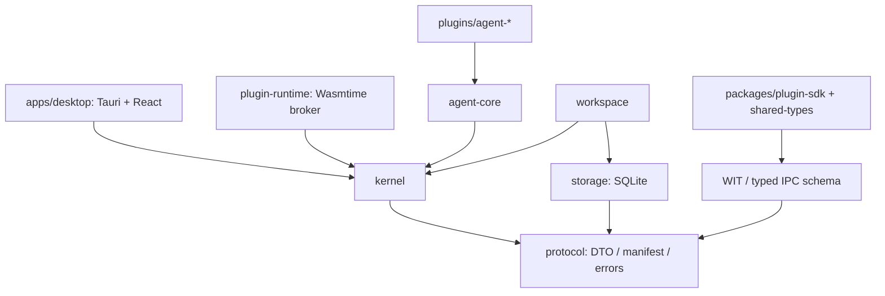
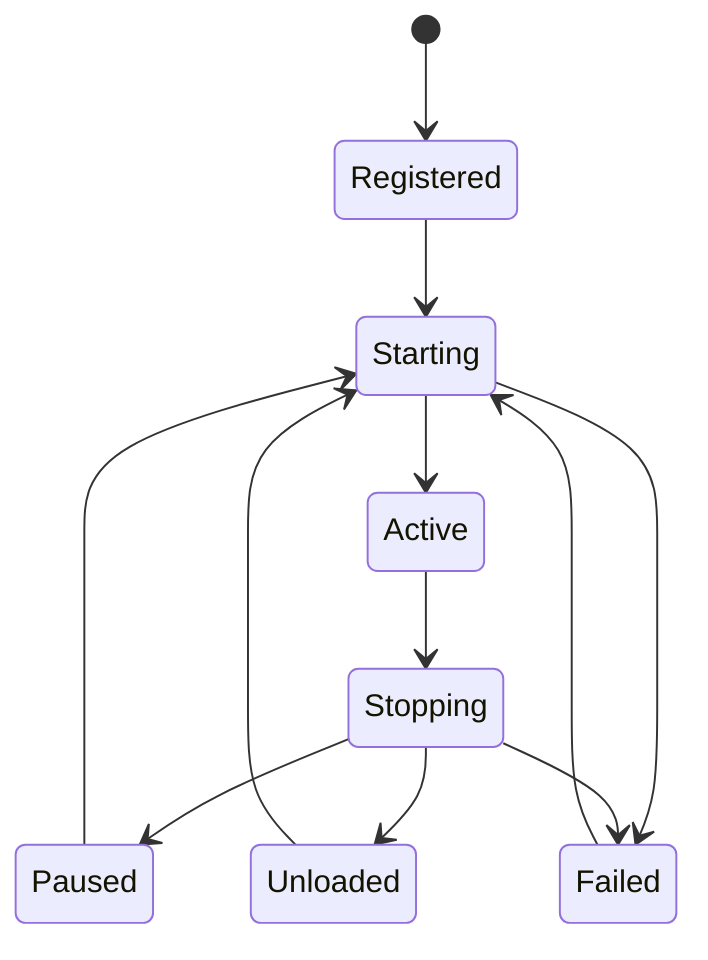

# virtade 架构设计 v0.1

> 这是先行设计文档，包含目标约束及后续工作，不代表全部能力已验收。当前实现及限制以 [验收记录](acceptance.md) 和 [插件协议 0.1](plugin-development.md) 为准。插件内核名称为 virt，宿主项目名称为 virtade。

状态：P0 设计基线；2026-11-08。本文先于原型编写。命名已统一为项目 virtade、内核 virt。P1 实际实现和偏差见 [原生接入记录](p1-native-agents.md) 与 [持久化记录](p1-persistence.md)；其余 P1–P3 仍是设计，不能视为已交付能力。

## 1. 结论与范围

方案可行。Rust 负责宿主资源和调度，原生 Agent 保留自己的 Harness；React 是工作台呈现层；第三方逻辑通过 WASM 组件运行，第三方 UI 通过独立、受控的渲染宿主运行。最小可信计算基包括内核、权限 broker、进程 supervisor、协议桥和签入源码的内置插件。不存在让所有基础设施也成为插件的无限递归：Tokio、注册表和权限裁决属于机制，Chat、Git、终端、Agent Provider 属于插件策略。

初始交付为 P0：一个 protocol crate 和一个按模块划分的 virt crate，三个示例插件、集成测试、跨平台 CI 配置。不提前创建空的桌面、WASM 或 UI 包。内置 Rust trait 仅限同一次构建，绝不构成公共二进制 ABI。

## 2. 复用组件调研与决策

查阅日期见文首；官方文档可能滚动更新，实施阶段必须锁定版本和重新验证行为。

| 组件 | 判断 | 采用方式 |
| --- | --- | --- |
| [Cordis](https://github.com/cordiverse/cordis) | 作用域、服务与资源随插件生命周期组织的思路适合 virtade；Node/TS 实现不直接移植 | 借鉴概念，不依赖、不复制实现 |
| [Wasmtime Component API](https://docs.wasmtime.dev/api/wasmtime/component/index.html) | WIT 生成绑定，组件 imports/exports 提供跨语言契约 | P2 首选，锁定稳定版本；不依赖文档站的 dev 版本 |
| [Extism](https://github.com/extism/extism) | 完整 WASM 插件宿主和多语言 PDK，可减少接入工作 | 候选而非默认；其 PDK ABI 与 WIT 路线不同，避免同时维护两套公共 ABI |
| [abi_stable](https://github.com/rodrimati1992/abi_stable_crates) | 原生 FFI 兼容性工具，不提供隔离，项目说明不支持卸载 | 不作为第三方格式 |
| [Shaku](https://docs.rs/shaku/latest/shaku/) | 编译期 DI，适合固定应用组合 | 不承担运行时覆盖、撤销和生命周期管理 |
| Tokio / tokio-util / futures-util | 任务、取消、Future panic 捕获 | P0 复用，不自建执行器 |
| semver / serde / serde_json / thiserror | 版本、序列化、错误 | P0 采用；JSON 是最小服务载荷，强类型端点在各 SDK 生成 |
| [Tauri 2 capabilities](https://v2.tauri.app/security/capabilities/) | 可限制窗口和 WebView 调用权限 | P1 桌面边界；不能代替 virtade 插件粒度权限 |
| SQLite + rusqlite | 本地单用户、事务持久化 | P1 专用阻塞任务队列；WAL、迁移、备份、busy timeout |
| Monaco / xterm.js + portable-pty / Git CLI | 编辑器、终端、跨平台 Git 已有成熟实现 | P3；Git 默认 CLI 以保留用户凭据链，必要时再用 git2 |
| React / Vite / Tailwind / shadcn/ui / Zustand | 工作台与可访问组件 | P1 采用，状态切片按 workspace/session，避免 token 级全树更新 |

未进行库性能排名或许可证法律结论；在引入每个生产依赖前记录其版本、许可证、NOTICE 和分发要求，生成 SBOM。第三方 Agent 的开源仓库许可证不等于账号、模型、商标或二进制再分发许可。

## 3. 模块依赖与部署

箭头表示编译依赖；kernel 不反向依赖 Agent、Tauri、存储或运行时。P0 将 service_registry、event_bus、scope、lifecycle 保留为 kernel 内部模块；有独立消费者或编译瓶颈后再拆 crate。前端 monorepo 在 P1 引入 pnpm workspace，apps/desktop、packages/ui、plugin-sdk、shared-types；P0 不引入 Node 依赖。

## 4. Context 与资源作用域

每次启动产生新 Context 和 ResourceScope；身份由宿主构造，不接受插件传入的 owner 字符串作为授权依据。Context 暴露注册、调用、订阅和托管任务，内部注册表不公开。所有注册必须经作用域锁完成，并在同一临界区登记撤销动作，杜绝卸载与注册竞态。清理动作后进先出。

卸载顺序：拒绝新操作 → 撤销服务/监听器 → 取消并 abort 任务 → await 任务完成 → 标记状态。注册回调与调用期间不持有注册表锁。关闭的 Context 永久失效，重载创建新 generation；持有旧 Context 不能重新注册或调用。返回的是服务调用结果，不向插件泄露可绕过撤销的服务 Arc。

P0 只承诺托管 Tokio 异步任务和注册资源的回收；禁止将 spawn_blocking、任意线程和子进程称为可被 abort 安全清理。内置 Rust 插件是可信代码，能绕过 Context 调用 OS；不具备对恶意 native 代码的隔离能力。panic=unwind 可在回调边界捕获；abort、内存破坏及不让出执行器的无限循环无法在进程内恢复。

## 5. Service Registry

- 服务身份为 `(namespace.name, major)`；协议小版本使用兼容性协商。插件清单独立使用 SemVer，依赖版本约束在启动前验证。
- 每个身份对应实现栈。底层实现必须主动声明 `replaceable`；覆盖者还必须获得宿主授予的该服务 override 权限。只有 replace 模式可以压栈，普通重复注册报 Conflict；禁止在不存在基础服务时假装覆盖成功。
- 覆盖层撤销后恢复最新存活实现；中间层和基础层撤销不会保留悬空指针，最后一层消失后返回 ServiceUnavailable。覆盖者不自动获得对旧实现的装饰器引用。
- 每次调用重新解析服务，并在提供者作用域内执行。覆盖只影响新调用；已开始的调用使用原实现，提供者卸载会取消这些调用。每个调用有 deadline，错误保留来源。
- 插件依赖是生命周期硬依赖；服务调用权限不是生命周期依赖。必须保证基础插件存在的覆盖插件应声明硬依赖，否则可以独立存活直至其实现被撤销。
- P0 使用版本化 JSON request/response 的 Service trait；它是宿主内部接口。P2 WIT 使用生成的值类型和不透明 resource handle；跨边界不传 Trait、Any、指针或任意 Tauri 命令名。

## 6. Event Bus 与 Hook

事件以命名空间 topic 区分，payload 在协议层可序列化。同步 hook 不执行 I/O，只返回 Continue/Intercept；异步 hook 依次执行，可有超时。数值优先级越高越先执行，同优先级按注册顺序。Intercept 终止本次派发，其余订阅不执行；错误和 panic 归因到插件，本次派发返回错误，其他派发仍可继续。

P0 emit 是可 await、顺序、带 deadline 的派发，无全局无限队列；sync hook 在托管异步任务中执行，其语义为回调同步，而不是阻塞调用者线程的 emit API。移除监听器后已经取出的快照仍必须检查 scope，关闭的监听器跳过。允许重入 emit，但调用者负责避免递归环；P1 加 trace/depth 上限。

P1 将高吞吐通知与可拦截 hook 分离：通知用有界 mpsc、每订阅者独立队列，声明 backpressure/drop/coalesce 策略。审批、状态转换、任务结束不可丢弃；文本 delta 可以合并，落库后再批量推送 UI。全局不承诺事件总序；每 session 由宿主赋单调 sequence。

## 7. 插件状态、依赖与故障

P0 生命周期操作串行执行（Kernel 方法需独占可变借用）；Context 数据面可并发。按插件 ID 排序进行确定性拓扑排序，启动前检测缺依赖、版本不匹配、环和 API 不兼容，诊断包含相关 ID。按依赖顺序启动，逆序卸载。start_all 仅回滚本次新启动集合，不能停止此前活跃插件。注册时记录插件声明，权限由宿主授权与请求交集决定，声明不等于授权。

卸载/暂停有活跃依赖者的插件默认拒绝；显式 cascade 才逆序停止依赖者。P0 暂停等同停止并释放全部作用域资源，恢复重新 start，不保留 Future 栈。reload 等同卸载后重新启动同一已注册工厂；从磁盘安装/更新 WASM 和失败时回滚旧版本在 P2 实现。stop hook 有限时，失败也强制清理。启动失败和 panic 自动撤销部分注册。回调错误返回给调用者并保留 owner；P0 不自动重启服务/事件处理失败的插件，避免无限重试风暴，P2 supervisor 增加熔断和退避策略。

实现细节：stop hook 在作用域已撤销、托管任务已等待清理之后运行，因此传入的 Context 只可查询身份/诊断，不能再调用服务或注册资源。stop hook 自身在单独的限时任务作用域中执行。unload 保留静态工厂与清单，便于重新启用，不表示从进程卸载 native 机器码。若外层生命周期 Future 被丢弃，RAII guard 同步撤销作用域；状态保留 Starting/Stopping，需要显式 unload 或 shutdown 收尾，禁止直接覆盖 Context 重启。start_all 的返回错误回滚本次启动集合，不承诺在调用者任意丢弃整个 Future 时异步回滚此前已启动的插件；宿主应串行执行并等待生命周期命令。

## 8. 跨语言协议、权限与 UI

P2 `virt:plugin@0.1.0` WIT world 包含 host services/events/config/contributions 与 guest lifecycle/callback dispatch。当前文档是协议设计，P0 不发布可误认稳定的空 SDK。每种端点定义 request/response schema、错误码和取消语义；binary/大文件使用受配额限制的资源句柄。稳定版本发布前做 Rust↔WASM↔TS fixture 往返测试。

WASM 每实例独立 Store，配置内存/表/实例数限制、fuel 与 epoch interruption，外部 timer 推进 epoch；host import 本身也必须有 deadline/取消，因为 fuel 不限制 host I/O。[Wasmtime 中断说明](https://docs.wasmtime.dev/examples-interrupting-wasm.html)支持这一路线；实际限额和开销需要 P2 spike 测量。默认不注入 WASI 目录、环境或网络。文件权限 broker 校验 canonical path、Windows 大小写/UNC/reparse point 与链接逃逸；网络按 origin/端口、DNS 重绑定、重定向重新裁决；进程只给命令模板和 argv，敏感服务单独授权。权限撤销使 capability handle 失效，并取消对应操作。

UI 插件不能作为 JS module import 到主 React realm，也不能获得主窗口 Tauri bridge。简单扩展使用声明式 schema 与宿主组件；任意第三方 UI 在无 Tauri 权限的独立 WebView/受 sandbox 限制的 frame 中运行，通过 origin/source 校验、会话 nonce、schema、配额验证的 MessagePort 访问 broker。不给 allow-same-origin 与同源宿主组合的逃逸机会。插件身份绑定端口，不由 payload 指定。React 组件、编辑器扩展均不能借机直接注入主执行域；声明式扩展可由主进程渲染，任意代码需隔离。WebView2 / WKWebView / WebKitGTK 行为必须分别验证后才能宣布隔离成立。

Contribution Registry 复用 scope 与 namespace ID，记录种类、版本、schema 和 owner，卸载触发 UI 移除；扩展点含 panels、sidebar、chat renderer、tool renderer、commands、menus、keybindings、status、settings、editor 和 workspace view。内置功能也走该机制。命令冲突默认拒绝，快捷键由用户规则解决；第三方 renderer 不允许覆盖审批安全界面。

## 9. Agent Provider 边界

virtade 负责发现、进程生命周期、会话索引、协议映射和 UI；Agent 负责推理、工具选择、上下文压缩、子 Agent、原生技能/插件及自己的恢复机制。不得使用统一 Agent Loop 替换其内部行为，也不得宣称 virtade 插件权限沙箱能自动限制 Agent 进程的全部 OS 操作。

Provider v1 拟议操作（P1 实现）：

| 操作 | 输入/输出及语义 |
| --- | --- |
| discover / capabilities | executable、原生版本、协议版本、auth 状态；不搜索或回显密钥；能力为 supported/unsupported/experimental，带限制原因 |
| start / shutdown | 配置化 argv、cwd、环境 allowlist、受保护凭据引用；返回实例 ID；关闭需取消任务、终结进程树 |
| create_session / resume / list / close | virtade ID 映射 provider-native session ID、工作区 ID、持久化 resume token；不存在的恢复必须报错 |
| submit | session、结构化输入、provider_options 命名空间；返回 task ID，禁止默默忽略不支持选项 |
| events | 有界流；envelope 含 schema_version、provider/version、session/task/item ID、sequence、timestamp、trace、normalized kind、原生 kind 与原始载荷 |
| cancel | 幂等请求取消，只有原生终态到达才标 cancelled；超时后显式 interrupted/unknown，强杀不得称为正常完成 |
| respond_approval | 一次性 request ID、allow/deny/受支持范围；超时默认拒绝；绑定 session/task，旧批准不得复用 |
| recover / health | 退出码、stderr 尾部、协议错误、是否可恢复；禁止自动重放可能产生副作用的 submit |

规范化事件：SessionState、TaskState、MessageDelta、MessageCompleted、ToolStarted/Updated/Completed、ApprovalRequested/Resolved、Usage、Diagnostic、ProviderEvent。未知原生事件保留 ProviderEvent，不丢字段；敏感原始数据加访问控制及保留策略，不直接输出到日志。审批不是普通 Event Bus hook，必须经过权限 broker 并落实到原生协议。

| Provider | 原生入口 | 关键限制与验证门禁 |
| --- | --- | --- |
| Claude Code | 优先官方 TS Agent SDK sidecar，通过 stdin/stdout 版本化 NDJSON 与 Rust 通信；简单批处理可选官方 CLI JSON 输出 | SDK 运行原生 Claude Code，保留权限、会话、工具与 hooks；查询、interrupt、resume、canUseTool 行为按锁定版本验证。SDK 的能力与用户交互 CLI 的全部功能不能画等号；sidecar 进程和运行时分发单独处理 |
| Codex | 官方 `codex app-server`，按官方初始化握手与双向请求/通知处理 | thread/start/resume、turn/start/interrupt、审批；从锁定二进制生成/校验协议 schema，稳定与实验字段区分；不是自行实现 JSON-RPC 服务端的 Agent Loop |
| DSH | P3 先验证官方 CLI/公开控制协议 | 已找到官方仓库，但本轮不承诺存在满足所有需求的稳定嵌入接口；不足时声明 terminal-only，保留原生 TTY，通过 upstream 公开接口扩展，不修改内部 Harness |

依据：[Claude SDK 概览](https://code.claude.com/docs/en/agent-sdk/overview)、[TS API](https://code.claude.com/docs/en/agent-sdk/typescript)、[Codex app-server](https://developers.openai.com/codex/app-server/)、[DSH 官方仓库](https://github.com/deepseek-ai/deepseek-harness)。各 Provider 上线必须记录实测原生版本；不能从文档存在推断端到端验证已完成。

## 10. 工作台、可靠性与风险

P1 主布局使用可调面板、会话列表和 Markdown Chat；布局持久化带 schema_version，恢复时剔除缺失插件视图。主题用 CSS tokens；Monaco 按需加载。Zustand 存规范化索引与局部状态，不保存无限 token 历史；消息虚拟滚动、增量批处理。

SQLite 保存 workspace、sessions、tasks、event cursor、plugin settings、layout；原生 Agent 历史仍由 Agent 管理。任务先持久化 submitting，再原生提交并保存 native task ID；崩溃后 unknown 状态要求核对，避免自动重发。写事务不跨 await。文件 watch 使用 notify 并 debounce，Git 及数据库阻塞操作走受限池。Windows 进程树使用 Job Objects，PTY 用 ConPTY；Unix process group，均测试优雅取消到强制终止的升级路径。

结构化 tracing 默认脱敏，包含 plugin/generation/session/task/trace 和耗时；metrics 记录队列长度、超时、调用量、取消耗时、内存。插件诊断暴露注册数量、任务状态、最近故障；导出日志由用户触发。

| 风险 | 应对及必须证明的证据 |
| --- | --- |
| 服务撤销后继续调用、资源泄漏 | scope 原子注册/关闭、过期 Context 拒绝、卸载 join；P0 并发与取消测试 |
| 覆盖规则不清导致越权或不能恢复 | 双向授权与实现栈、非栈顶卸载测试 |
| native panic 与恶意代码 | 可信内置只捕获 unwind；第三方强制隔离；明确进程内不可恢复故障 |
| WASM 编译/内存开销与 ABI 演进 | 按需实例化、缓存、稳定 WIT、版本协商；不先承诺资源数字 |
| UI 扩展越权 | 独立 realm、无 IPC capability、端口绑定身份；P2 恶意 UI 测试 |
| Agent 版本变化 | 锁定支持范围、真实 fixture/集成任务、能力探测，拒绝伪兼容 |
| Windows 路径、终端、进程树 | Windows 优先 CI 和实际桌面验收；Linux 测试结果不替代 Windows 结论 |
| 高并发及慢消费者 | 有界队列、deadline、取消；P0 不宣称已达到生产吞吐 |

性能基准在功能正确后建立 release baseline：无插件/10/100 插件启动时间，1/10/100 监听器派发，服务调用吞吐及 p50/p95/p99，10k 次加载卸载后资源数量与 RSS，UI 首屏/常驻内存，以及并行 Agent 下 UI 延迟。结果记录硬件、OS、构建配置和原始数据，P0 先验证语义，不给未经测量的性能保证。
