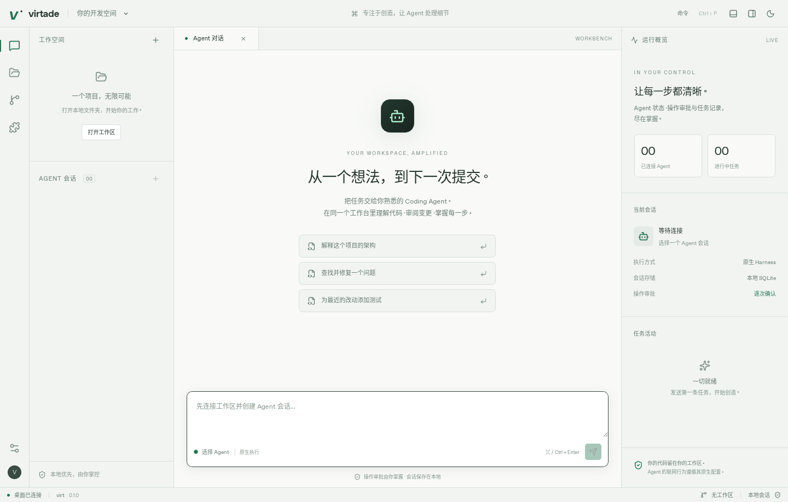

# 桌面开发与原生验证

virtade 使用 Rust 1.99.1、Node 24、pnpm 11.25.0。首次执行 `pnpm install --frozen-lockfile` 和 `pnpm build`，会构建 Claude SDK bridge、UI SDK 与桌面前端。只运行内核测试不需要系统 WebView。

## Windows（首要目标）

安装 Visual Studio 2022 Build Tools 的 Desktop development with C++、Windows SDK、Microsoft Edge WebView2 Runtime、Rust MSVC 工具链、Node、pnpm 和 Git。终端使用 Windows PowerShell / ConPTY；Codex、Claude、DSH 必须由用户安装和认证。设置页可填写实际程序路径；不通过 shell 字符串启动 Agent。

```powershell
pnpm install --frozen-lockfile
pnpm build
pnpm --filter @virtade/desktop tauri dev
# 编译带嵌入前端的可执行程序，不签名、不发布
pnpm --filter @virtade/desktop tauri build --no-bundle
```

Claude bridge 使用 `packages/claude-bridge/dist/main.js`，需要保留其相邻 Node 依赖。开发 checkout 默认可找到；移动可执行程序后，必须在设置中指定已构建 bridge 的绝对路径及 Node 路径。当前不是独立携带所有 Agent/Node 的单文件发行包。

## Linux / macOS

Debian/Ubuntu 安装 `build-essential pkg-config libwebkit2gtk-4.1-dev libappindicator3-dev librsvg2-dev patchelf`；macOS 安装 Xcode Command Line Tools。其余命令与 Windows 一致。Linux 终端默认使用 SHELL 或 bash，macOS 使用系统 WebView。

`pnpm --filter @virtade/desktop dev` 仅启动浏览器预览，界面会明确提示本地能力不可用。使用 `tauri dev` 才连接 Rust 宿主。默认 Cargo feature 不编译桌面系统依赖；`desktop` 启用原生壳，`custom-protocol` 启用嵌入的前端资源。

## 验证与隔离

```sh
cargo fmt --all --check
cargo clippy --workspace --all-targets --locked -- -D warnings
cargo test --workspace --all-targets --locked
pnpm check
pnpm build
pnpm --filter @virtade/desktop exec playwright install chromium
pnpm test
```

Playwright 的 fixture 只存在于 Vite test 模式，生产前端不载入模拟宿主。浏览器测试覆盖工作区、会话、单次审批、opaque iframe 与 MessageChannel、Monaco 本地 worker 和保存版本、Git 工作区切换竞态和原生错误展示。原生 PTY、Git/worktree、文件越界/保存冲突由真实系统组件集成测试验证。

原生冒烟另编译 `native-smoke,custom-protocol` feature：测试脚本在实际 WebView 检查 React、内置插件、nonce 拒绝、IPC/SQLite 和主题切换，通过专用报告命令退出。**普通构建没有该报告/退出 IPC**。仅使用一次性数据目录；测试会改写其中的 DSH 设置。

```sh
export XDG_DATA_HOME="$(mktemp -d)"
export VIRTADE_SMOKE_REPORT="$XDG_DATA_HOME/report.json"
cargo build -p virtade-desktop --features native-smoke,custom-protocol --locked
timeout 40 xvfb-run -a target/debug/virtade-desktop
cat "$VIRTADE_SMOKE_REPORT"
```

CI 区分三平台 Rust 合同测试、Linux 浏览器回归和三平台 Tauri 编译；Linux 另运行原生冒烟。配置 CI 不等于远端 CI 已运行通过。真实账号任务、Windows/macOS 交互与安装分发验收需另留证据。

插件页的“导出诊断”下载结构化 JSON：版本、平台、资源数量、运行状态与故障计数；主动排除提示词、原始事件、审批令牌和本地路径。插件卡片保留本地详细诊断供开发调试。依赖许可清单见 [THIRD_PARTY_NOTICES.md](../THIRD_PARTY_NOTICES.md)，用 `python3 scripts/third-party-notices.py` 重建；它不替代发行包所需的上游 license/NOTICE 文本。

原生窗口截图：


