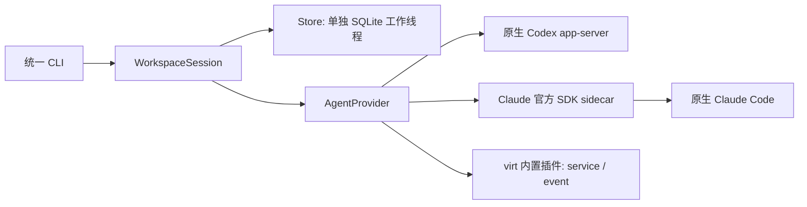

# P1-02：Claude Rust Provider 与本地持久化

日期：2026-11-08。当前是可通过 CLI 验证的宿主增量，尚未完成桌面 P1 的真实 Agent 验收。

## 完成的调用链

两个 Agent 共享 `AgentProvider`、类型化公共 service 和宿主审批接口：



`virt` 不依赖 SQLite 或任何 Agent。`agent-core` 依赖 virt 的 Service 接口；`workspace` 只依赖 AgentProvider 和存储，不依赖具体 Provider 或 Tauri。CLI 用同一 Provider 实现，插件宿主通过相同版本化 service 调用。两个内置插件都把审批响应留在可信宿主方法中，普通 ServiceCall 无法批准工具。

## Claude Provider

新增 `plugins/agent-claude`：发现 bridge 协议版本与能力、创建/恢复 session、提交/中断任务、完整原生 SDK 消息、期限内一次性审批、进程退出和插件卸载清理。请求和响应使用上一增量的受控 stdio RPC，无第三方原生动态库。

新 session 的 `reserved=true` 表示 SDK query 尚未创建原生历史，不能假装已经持久化。收到 SDK init 或经过原生 resume 验证后，数据库将 reserved 清除。桥接握手只探测 SDK 版本，尚未检测 Claude Code 二进制版本、认证或模型连通性。

Claude Task 的 `native_id` 是 Provider 不透明 ID，实际为 bridge query UUID，并非 Anthropic 提供的可恢复 turn ID；能力表明确 tasks.resume 不支持。session ID 在 query 后才是原生 transcript ID。未知 query 结果必须核对历史，不能根据桥接 UUID 自动重放。

工具审批 token 在 Rust 宿主重新随机生成，绑定 bridge request/session/task/有效期；不同会话、不同任务、重复和过期响应均拒绝。host timeout 比 bridge 自身超时短，失联或取消默认拒绝。流结束若没有可靠原生 result 则 outcome=Unknown，不能把 interrupt 的成功响应当成 Cancelled。Codex 的 interrupted 原生终态才映射 Cancelled。

Provider service 改为 agent-core 中的公共类型化实现，拒绝未声明方法和额外字段。每条 AgentEvent 可携带统一 TaskOutcome；全部原生 payload 保留。Claude 工具事件当前仍主要以原生数据暴露，细粒度 UI 规范化留待桌面阶段。

## SQLite 与任务状态

采用 rusqlite 0.41.1 + bundled SQLite。连接只在一个专用线程内使用，Tokio 侧通过容量 64 的队列提交操作；没有在 UI/Tokio 主执行路径同步执行 SQL。启用 WAL、foreign_keys、FULL synchronous 和 5 秒 busy timeout。事务中不跨 await。

schema v1 包含 workspaces、sessions、tasks、events；记录本地 UUID 和 Provider ID/原生会话 ID 映射。数据库 application_id 为 VRTA，拒绝修改其他应用已有数据库和比宿主更新的 schema；迁移与启动恢复在一个事务中执行。数据库 OS 文件锁贯穿工作线程生命周期，同时只允许一个 virtade Store 拥有该数据库。关闭需 await close，完成线程退出和锁释放。

提交顺序为：提交 Submitting 意图事务 → 原生 submit → 保存 Provider task ID 和 Running → 消费事件。每个 session 只有一个 Submitting/Running/Unknown 任务；request_key 唯一，重复 key 明确返回已记录错误而不是许可再提交。原生响应丢失、提交异常和外层 Future 被取消时保留意图，禁止自动重放。

重新打开数据库将 Submitting/Running 转为 Unknown，已经完成的任务不受影响。由于先取得 OS 锁，这一恢复不会误伤另一个活跃 virtade 实例的任务。SQLite 故障、Provider 故障与业务错误分别保留错误类型。

Unknown 的存储恢复接口只允许显式绑定从 Agent 历史核对出的 task ID；绑定本身不表示完成，必须再写入身份匹配的原生终态事件才能解除阻塞。当前没有自动历史核对器或 UI 恢复向导，CLI 只展示任务并拒绝重提；对尚未返回 task ID 的原生 submit 无法推断其结果。

事件落库使用每 session 持久化递增游标，保留 Provider connection-local sequence。每次宿主会话连接产生新的 stream_id，用 `(local_session, stream_id, provider_sequence)` 幂等去重；相同 key 不同内容报错。事件插入、游标推进、任务终态和必要的 session reserved 更新在同一事务中完成。终态必须匹配已保存的 Provider/session/task ID，已经确定的 Completed/Failed/Cancelled 不得被不同结果覆盖。native unknown 事件可以在后续真实终态出现时收敛。

`WorkspaceSession` 在 UI/CLI 接收事件前先落库。未绑定具体 session 的原生全局通知不会错误地归入当前会话；CLI 显式输出，但目前不持久化全局通知。持久化后的历史支持 cursor/limit 查询，CLI history 暂显示前 100 条；原生 Agent 流仍没有断点重放协议，数据库游标不能补回宿主未收到的事件。

## CLI 使用

```sh
cargo run -p virtade-cli -- doctor codex
cargo run -p virtade-cli -- doctor claude
cargo run -p virtade-cli -- run codex <cwd> <database> "任务"
cargo run -p virtade-cli -- run claude <cwd> <database> "任务"
cargo run -p virtade-cli -- sessions <database> <cwd>
cargo run -p virtade-cli -- run claude <cwd> <database> "后续任务" --resume <local-session-id>
cargo run -p virtade-cli -- tasks <database> <local-session-id>
cargo run -p virtade-cli -- history <database> <local-session-id>
```

旧的 `virtade codex ... --resume <native-id>` 已替换为统一 run 命令；当前项目未发布，不保留歧义别名。显式指定数据库，父目录需存在，建议放在源码工作区外。原生身份由本地 ID 映射，不能在恢复时混用其他 workspace/provider。

CLI 目前默认拒绝审批，不提供自动批准或 bypassPermissions；Ctrl+C 使用原生取消，再等待终态，等待失败或超时保留 Unknown。执行 run 可能使用真实 Agent 额度并修改工作目录；普通测试使用 synthetic fixture，不发起模型请求。

数据库为本地明文，包含提示词和原生消息；不应把它提交到仓库。Unix 新数据库以 0600 创建，Windows 使用所在目录 ACL；没有实现数据库加密、自动备份和保留期清理。批准 token 可能出现在短期原生事件历史中，但不作为恢复后的有效授权，重启后旧批准无效。

## 验证结果与边界

Linux x86_64、Rust 1.99.1、Node 24。Rust 共 64 项测试通过：27 内核 + 9 transport + 6 Codex + 5 Claude + 10 SQLite + 5 workspace + 2 CLI。Node bridge 4 项测试通过。fmt、Clippy 无警告、TypeScript 类型检查和构建通过。

关键证据包括：审批身份与一次性限制、bridge 崩溃、无 result 的取消保持 Unknown、新会话 reserved、单写者锁、迁移及未来/外来数据库拒绝、跨重连事件幂等、终态原子更新、显式恢复绑定、提交前意图已提交、取消 submit Future 仍阻止重放、CLI 跨进程恢复同一本地会话，以及 Agent 崩溃后 CLI 拒绝新任务。

两个真实入口的 doctor 通过：Codex `0.167.0-alpha.4` app-server，Claude 官方 SDK `0.3.319` 经新 Rust Provider 握手。未执行付费模型任务或验证真实代码修改。Claude/Codex Provider 的 Windows GNU 目标检查通过；本轮 SQLite/CLI 仅在 Linux 构建与运行，bundled SQLite 的原生 C 构建和 Windows 运行依赖三平台 CI/真实 Windows 环境验证，不能由 Rust Provider 的交叉检查替代。

下一步是 Tauri 2 + React 最小工作台、受控 IPC、人工审批、会话历史恢复，以及 Windows 上两个原生 Agent 的真实代码任务验收。P2 第三方 WASM/UI 插件宿主尚未实现。
